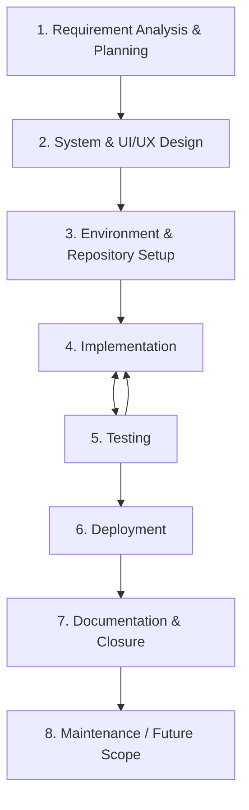

# Software Development Life Cycle (SDLC)
## Real-Time Chat Application — College Major Project (7th Semester)

This is the master process document for the project — it lays out every phase from requirement gathering to deployment and closure, and points to the other project documents for the technical detail behind each phase. Treat this as the index; the other files are where the actual specifics live.

---

## 1. SDLC Model Used

This project follows an **incremental / iterative model in practice**, even though it's documented here as classic sequential phases (which is what most academic report formats expect). In reality, implementation and testing loop back on each other constantly — you don't finish all of "Implementation" before starting any "Testing." The diagram below reflects that.

**Why incremental rather than pure waterfall:** the real-time layer (Section 4.4 below) depends on the REST auth layer being correct first, and the frontend depends on stable API contracts — but within each layer, you build a small piece, test it immediately, then move to the next. Waiting to test until "Implementation" is fully done (true waterfall) would mean debugging every layer's mistakes simultaneously at the end, which is much harder to untangle.

---

## 2. Phase-by-Phase Breakdown

### Phase 1: Requirement Analysis & Planning

**Goal:** Agree on exactly what's being built before anyone writes code.

**Activities:**
- Define functional scope — MVP features vs. stretch goals (see `ARCHITECTURE.md` sections 1.1–1.2)
- Define non-functional requirements — latency, concurrency, availability targets (section 1.3)
- Finalize the technology stack (`ARCHITECTURE.md` section 2)
- Assign initial team roles (who leans backend, who leans frontend, who owns UI/UX)

**Deliverables:** Software Requirements Specification (SRS) draft — can be lifted almost directly from `ARCHITECTURE.md` sections 1–2.

**Duration:** Week 1

---

### Phase 2: System & UI/UX Design

**Goal:** Design the system on paper (and in Figma) before building it, so implementation doesn't require constant re-decisions.

**Activities:**
- System architecture, database schema (ERD), REST API contract, Socket.IO event contract — all in `ARCHITECTURE.md` sections 3, 6, 7, 8
- UI/UX design in Figma, with frame/component names matching the frontend structure in `ARCHITECTURE.md` section 4.1 (so implementation later maps 1:1 to designs)
- Shared design tokens (colors, spacing, typography) established as a Tailwind theme, sourced from Figma

**Deliverables:** `ARCHITECTURE.md` (already generated), Figma file, ER diagram, API/event contract tables.

**Duration:** Weeks 1–2 (overlaps with Phase 1's tail end — design can start once scope is locked, without waiting for every planning detail)

---

### Phase 3: Environment & Repository Setup

**Goal:** Get every teammate to a working, identical local environment with zero ambiguity about versions or workflow.

**Activities:**
- `package.json` for both `client/` and `server/` with pinned dependency versions
- Git repository created, pushed, branch-protected, teammates added as collaborators (`GIT_WORKFLOW.md`)
- `AGENTS.md` in place so AI-assisted development (Cursor) follows consistent conventions from the first prompt

**Deliverables:** Live GitHub repo, all teammates cloned and able to run `npm install` successfully in both folders.

**Duration:** Week 2, in parallel with the tail end of Phase 2

---

### Phase 4: Implementation

**Goal:** Build the system in dependency order — backend before frontend, auth before real-time, core features before polish — per the reasoning that the frontend has nothing real to call until the backend exists.

Full step-by-step prompts for this phase live in `PROMPTS.md`. Summary of the build order:

| Sub-phase | Scope | Reference |
|---|---|---|
| 4.1 Backend scaffolding & auth | Folder structure, DB models, JWT register/login/refresh | `PROMPTS.md` Phase 1 |
| 4.2 Core REST APIs | Users, conversations, paginated message history | `PROMPTS.md` Phase 2 |
| 4.3 Real-time layer | Socket auth, `message:send`/`message:new`, read receipts | `PROMPTS.md` Phase 3 |
| 4.4 Presence & typing | Online/offline status, typing indicators | `PROMPTS.md` Phase 4 |
| 4.5 Group chat | Group creation, membership, group messaging | `PROMPTS.md` Phase 5 |
| 4.6 Frontend | Scaffolding, API/socket clients, auth pages, chat UI | `PROMPTS.md` Phase 6 |
| 4.7 Polish | Validation, error handling, stretch features | `PROMPTS.md` Phase 7.1 |

**Team parallelization:** once Phase 4.2 (core REST APIs) is stable, frontend work can start in parallel with the backend team continuing into 4.3–4.5 — the frontend dev builds against the already-working REST endpoints while sockets are still being built, then wires in real-time features once 4.3–4.4 land. This is reflected in the master timeline in Section 3.

**Deliverables:** Working backend and frontend, merged to `main` via the PR workflow in `GIT_WORKFLOW.md`.

**Duration:** Weeks 3–11

---

### Phase 5: Testing

**Goal:** Catch bugs before the demo, not during it.

**Activities:**
- Unit tests for services (auth logic, message creation) — Jest
- Integration tests for REST endpoints — Supertest + `mongodb-memory-server`
- Manual multi-client testing for real-time features (two browser tabs/windows sending messages, checking typing indicators and presence)
- Bug tracking via GitHub Issues, fixed via the branch/PR workflow

**Reference:** `ARCHITECTURE.md` section 12 (Testing Strategy), `PROMPTS.md` Phase 7.2

**Deliverables:** Test suite, a short test report summarizing coverage and known issues for your submission.

**Duration:** Ongoing throughout Phase 4, with a dedicated hardening pass in Week 11–12

---

### Phase 6: Deployment

**Goal:** Get a live, demoable version of the app running outside your laptop.

**Activities:**
- Dockerize both apps, `docker-compose.yml` for local multi-service testing (Mongo + Redis + server)
- Deploy frontend to Vercel/Netlify, backend to Render/Railway, database to MongoDB Atlas
- Verify environment variables are set correctly on each platform (never commit real values — see `GIT_WORKFLOW.md`)

**Reference:** `ARCHITECTURE.md` section 10, `PROMPTS.md` Phase 7.3–7.4

**Deliverables:** A public URL you can open on demo day without running anything locally.

**Duration:** Week 12–13

---

### Phase 7: Documentation & Closure

**Goal:** Package the project for submission and evaluation.

**Activities:**
- Finalize the SRS, ER diagram, and architecture diagrams (mostly already produced in `ARCHITECTURE.md`)
- Write a project report combining the SRS, design docs, testing report, and screenshots of the working app
- Prepare a demo script — what you'll show, in what order, and a fallback plan if live sockets misbehave during the demo (e.g., a short recorded backup video)
- Prepare for viva questions — the reasoning behind key decisions (why Socket.IO over raw WebSockets, why Redis is designed-for-but-optional, why REST for CRUD and sockets only for real-time) is exactly the kind of thing examiners ask, and it's already written out in `ARCHITECTURE.md`

**Reference:** `ARCHITECTURE.md` section 14 (Academic Deliverables Checklist)

**Deliverables:** Final report, README, live demo, viva readiness.

**Duration:** Week 13–14

---

### Phase 8: Maintenance & Future Scope (post-submission)

Classic SDLC includes a maintenance phase; for a college project this is really "what you'd do next if you kept building it." Worth a short section in your report even if you don't build it:

- Voice/video calling via WebRTC
- End-to-end encryption
- Message search (MongoDB text index, or Elasticsearch at larger scale)
- Push notifications for offline users
- Horizontal scaling validation (actually running multiple backend instances behind the Redis adapter, not just designing for it)

---

## 3. Master Timeline

Assuming a ~14-week semester, with backend and frontend/design tracks running in parallel once dependencies allow:

| Week | Phase | Backend Track | Frontend / Design Track |
|---|---|---|---|
| 1 | Requirement Analysis | Finalize scope & stack | — |
| 2 | System & UI/UX Design | Finalize DB schema, API/socket contracts | Figma wireframes → high-fidelity screens |
| 2 | Environment Setup | Repo, `package.json`, `AGENTS.md`, branch protection (all team) | |
| 3–4 | Implementation — Core | Auth + REST CRUD (4.1–4.2) | Design tokens finalized; frontend scaffolding begins |
| 5–7 | Implementation — Real-time | Socket.IO messaging, read receipts (4.3) | Auth pages + API client wired to real REST endpoints |
| 8 | Implementation — Presence | Typing & presence (4.4) | Socket hook + core chat UI wired |
| 9 | Implementation — Group chat | Group backend (4.5) | Group chat UI, typing/presence UI polish |
| 10–11 | Polish | Validation, error handling (4.7) | Stretch features, UI polish, integration testing |
| 11–12 | Testing | Backend test suite | Manual/E2E multi-client testing, bug fixes via Issues/PRs |
| 12–13 | Deployment | Docker Compose, cloud deploy | Final QA on the deployed build |
| 13–14 | Documentation & Closure | Final report, demo prep, viva readiness (all team) | |

---

## 4. Team Roles & Responsibilities

Fill in with actual names — structure below is a starting template based on the tracks above.

| Role | Person | Primary phases |
|---|---|---|
| Backend lead | _(you)_ | Phase 4.1–4.5, 5 (backend tests) |
| Frontend lead | _(teammate)_ | Phase 4.6, 5 (manual/E2E testing) |
| UI/UX & Figma | _(teammate)_ | Phase 2, ongoing design review through Phase 4.6 |
| QA / Integration | _(rotate or shared)_ | Phase 5 throughout |
| Documentation & report | _(rotate or shared)_ | Phase 1, 7 |

Even with defined leads, everyone should be able to open a PR against any part of the codebase — the branch protection + review workflow in `GIT_WORKFLOW.md` is what keeps that safe, not strict ownership silos.

---

## 5. Risks & Mitigations

| Risk | Mitigation |
|---|---|
| Real-time bugs are hard to reproduce and debug | Test every socket feature with two browser tabs/windows from the start, not just at the end — catch broadcast/room bugs immediately |
| Scope creep — trying to build every stretch goal | MVP vs. stretch is already split in `ARCHITECTURE.md` section 1; treat stretch goals as optional and only start them after the MVP roadmap (Phase 4.1–4.5) is fully working |
| Merge conflicts from parallel backend/frontend work | Small, scoped PRs per `GIT_WORKFLOW.md`; pull `main` into a branch regularly if a task spans multiple days |
| Live demo failing due to network/socket issues | Deploy early (don't leave Phase 6 to the last two days) and keep a short recorded backup demo as a fallback |
| Team members blocked waiting on each other | The parallelization plan in Section 3 exists specifically so frontend isn't idle while backend finishes sockets — once core REST is done, frontend has real work to do independently |

---

## 6. Project Document Index

| Document | Purpose |
|---|---|
| `ARCHITECTURE.md` | Full technical design — stack, schema, API/event contracts, security, scaling |
| `AGENTS.md` | Persistent context for Cursor — conventions, architecture rules, what to avoid |
| `PROMPTS.md` | Sequential, copy-pasteable Cursor prompts for the entire build |
| `GIT_WORKFLOW.md` | Git/GitHub setup, branching, PR, and merge workflow for the team |
| `SDLC.md` *(this file)* | Master phase plan, timeline, roles, and risk tracking |
