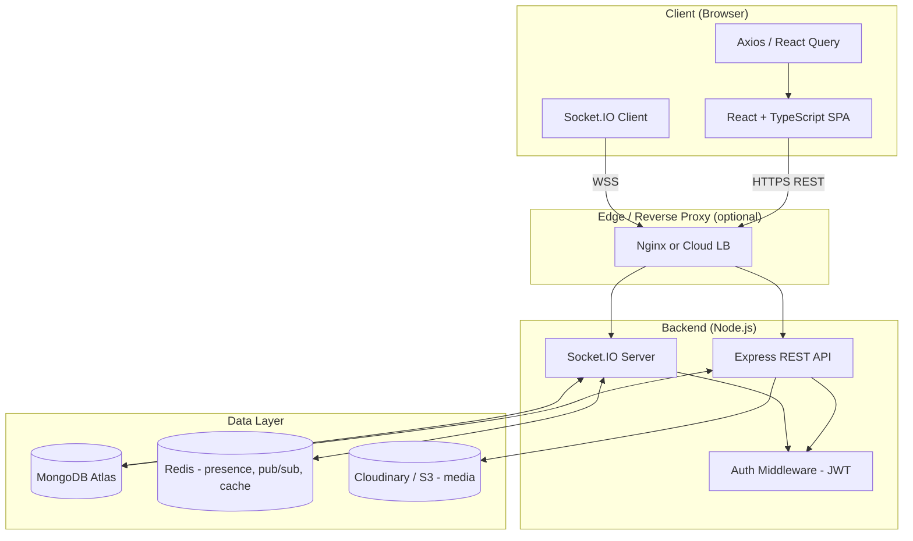
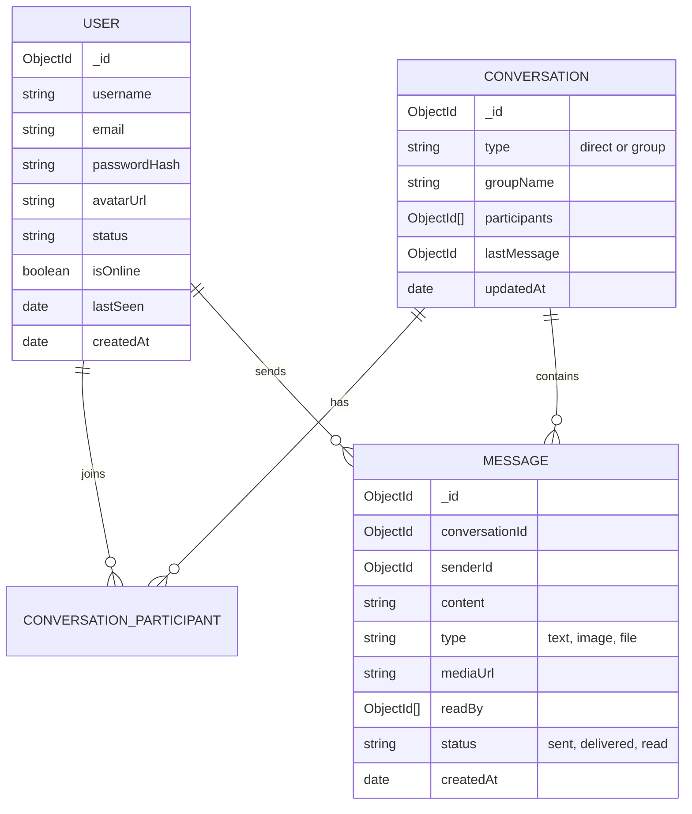
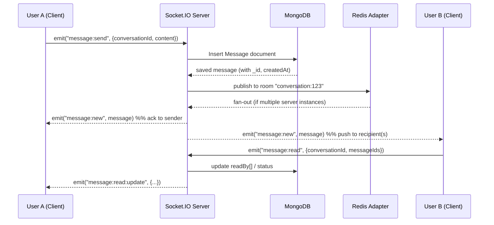
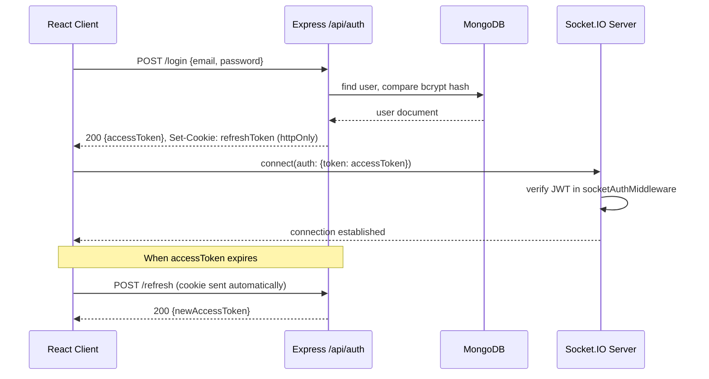
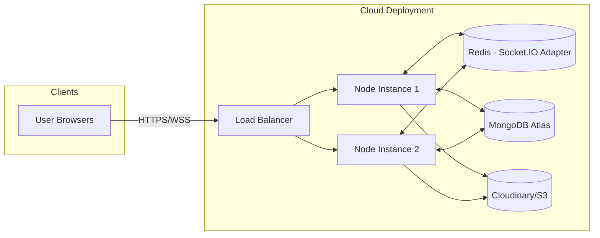

# Real-Time Chat Application — System Architecture & Design Document

**Project type:** College Major Project (7th Semester)
**Stack:** React + TypeScript · Node.js + Express · Socket.IO · MongoDB

---

## 1. Project Overview

A web-based real-time chat application allowing registered users to have one-to-one and group conversations, with instant message delivery, typing indicators, online presence, and read receipts. The system is built as two independently deployable applications — a React SPA (client) and a Node/Express API + WebSocket server (backend) — communicating over REST (for CRUD/auth) and Socket.IO (for real-time events).

### 1.1 Functional Scope (MVP)
- User registration & login (JWT-based auth)
- User search / contact list
- One-to-one real-time messaging
- Group chat (create group, add/remove members, group messaging)
- Message persistence & history (paginated)
- Online/offline presence indicator
- Typing indicator
- Message delivered/read receipts
- Basic profile management (avatar, status message)

### 1.2 Stretch Goals (if time permits)
- Image/file sharing in chat
- Push notifications (browser)
- Message reactions (emoji)
- Message search
- Voice/video calling (WebRTC)
- End-to-end encryption

### 1.3 Non-Functional Requirements
| Requirement | Target |
|---|---|
| Message delivery latency | < 200ms on same-region deployment |
| Concurrent connections (demo scale) | 100–500 sockets |
| Availability | Single-region, best-effort (college deployment) |
| Data durability | MongoDB persistence for all messages |
| Security | Passwords hashed, JWT-secured routes & sockets |

---

## 2. Technology Stack

### 2.1 Core stack (as specified)

| Layer | Technology | Purpose |
|---|---|---|
| Frontend | React 18 + TypeScript | Component-based UI, type safety |
| Frontend build tool | Vite | Fast dev server & build |
| Backend runtime | Node.js | JS runtime for server |
| Backend framework | Express.js | REST API routing & middleware |
| Real-time layer | Socket.IO | WebSocket abstraction (with fallback) |
| Database | MongoDB (Atlas or local) | Document store for users/messages |
| ODM | Mongoose | Schema modeling & validation for MongoDB |

### 2.2 Recommended additions

| Category | Technology | Why |
|---|---|---|
| Backend language | TypeScript (on Node too) | Shared types between client/server, fewer runtime bugs — strongly recommended given you're already using TS on frontend |
| State management | Zustand or Redux Toolkit | Predictable global state for auth, active chat, socket status. Zustand is lighter and easier to justify for a college project |
| Styling | Tailwind CSS + shadcn/ui | Fast, consistent UI without hand-rolling CSS |
| Data fetching (REST) | TanStack Query (React Query) | Caching, retries, background refetch for REST calls, pairs well with sockets for cache invalidation |
| Auth | JWT (access + refresh tokens) + bcrypt | Stateless auth; bcrypt for password hashing |
| Horizontal scaling of sockets | Redis + `@socket.io/redis-adapter` | Lets multiple Socket.IO server instances share events/rooms — good talking point for scalability even if you run 1 instance in the demo |
| Presence/typing cache | Redis | Fast ephemeral state (who's online, who's typing) instead of hitting MongoDB |
| File/image uploads | Multer (upload handling) + Cloudinary or AWS S3 (storage) | Don't store binary files in MongoDB |
| Validation | Zod (shared schema validation frontend+backend) | Single source of truth for request/response shapes |
| API documentation | Swagger / OpenAPI (`swagger-jsdoc` + `swagger-ui-express`) | Professional touch, useful for your report/viva |
| Logging | Winston + Morgan | Structured logs, HTTP request logs |
| Security middleware | Helmet, CORS, express-rate-limit, express-mongo-sanitize | Baseline hardening |
| Testing | Jest + Supertest (backend), React Testing Library (frontend) | Demonstrates engineering rigor for evaluation |
| Containerization | Docker + Docker Compose | Spin up Mongo + Redis + backend + frontend with one command — great for demo day |
| CI | GitHub Actions | Lint/test on push, good for the report |
| Deployment | Vercel (frontend) + Render/Railway (backend) + MongoDB Atlas (DB) + Upstash (Redis) | All have free tiers suitable for a student project |
| Push notifications (stretch) | Web Push API / Firebase Cloud Messaging | Notify offline users |
| Voice/video (stretch) | WebRTC (with Socket.IO for signaling) | Natural extension once chat is stable |
| Message search (stretch) | MongoDB text indexes (simple) or Elasticsearch (advanced) | Text index is enough for a college project |

> **Scoping advice:** Build the MVP fully with the "Core stack" + the starred essentials (TypeScript backend, Zustand, Tailwind, JWT, Redis-ready design). Treat WebRTC, E2E encryption, and Elasticsearch as optional "future work" sections in your report rather than build targets — they're disproportionately time-expensive for a semester timeline.

---

## 3. High-Level Architecture



**Flow summary:**
1. React app authenticates via REST (`/api/auth/*`), receives a JWT.
2. On login, the client opens a Socket.IO connection, passing the JWT in the handshake `auth` payload.
3. The Socket.IO server verifies the JWT via middleware before allowing the connection.
4. Real-time events (messages, typing, presence) flow over the socket; all other CRUD (fetch history, manage profile, create groups) flows over REST.
5. Redis is used both as the Socket.IO adapter (so events broadcast correctly across multiple server instances) and as a fast key-value store for presence/typing state.

---

## 4. Frontend Architecture (React + TypeScript)

### 4.1 Folder structure

```
client/
├── src/
│   ├── api/                 # Axios instance + REST API functions
│   │   ├── axiosClient.ts
│   │   ├── authApi.ts
│   │   ├── userApi.ts
│   │   └── messageApi.ts
│   ├── components/
│   │   ├── chat/
│   │   │   ├── ChatWindow.tsx
│   │   │   ├── MessageBubble.tsx
│   │   │   ├── MessageInput.tsx
│   │   │   ├── TypingIndicator.tsx
│   │   │   └── ConversationList.tsx
│   │   ├── common/           # Buttons, Avatar, Modal, etc.
│   │   └── layout/           # Sidebar, Navbar
│   ├── context/ (or store/)  # Zustand stores
│   │   ├── authStore.ts
│   │   ├── chatStore.ts
│   │   └── socketStore.ts
│   ├── hooks/
│   │   ├── useSocket.ts
│   │   ├── useAuth.ts
│   │   └── useTypingIndicator.ts
│   ├── pages/
│   │   ├── LoginPage.tsx
│   │   ├── RegisterPage.tsx
│   │   ├── ChatPage.tsx
│   │   └── ProfilePage.tsx
│   ├── types/
│   │   ├── user.ts
│   │   ├── message.ts
│   │   └── socketEvents.ts   # shared event name + payload types
│   ├── routes/
│   │   └── AppRouter.tsx     # React Router config incl. protected routes
│   ├── utils/
│   ├── App.tsx
│   └── main.tsx
├── .env
├── package.json
└── vite.config.ts
```

### 4.2 Key design decisions
- **Single Socket.IO connection**, established once after login and stored in a `socketStore` (or React Context), reused across all chat components — avoid opening a new socket per component.
- **Optimistic UI**: when a user sends a message, render it immediately with a `pending` status, then reconcile with the server's acknowledgment/broadcast.
- **Pagination**: message history loaded via REST with cursor-based pagination (`?before=<messageId>&limit=30`), not through sockets.
- **Protected routes**: a route guard checks for a valid JWT (in memory + refresh via httpOnly cookie, see Section 7) before rendering `ChatPage`.

---

## 5. Backend Architecture (Node + Express + Socket.IO)

### 5.1 Folder structure

```
server/
├── src/
│   ├── config/
│   │   ├── db.ts             # MongoDB connection
│   │   ├── redis.ts          # Redis connection
│   │   └── env.ts            # env var validation
│   ├── models/
│   │   ├── User.ts
│   │   ├── Conversation.ts
│   │   ├── Message.ts
│   │   └── Group.ts
│   ├── routes/
│   │   ├── authRoutes.ts
│   │   ├── userRoutes.ts
│   │   ├── conversationRoutes.ts
│   │   └── messageRoutes.ts
│   ├── controllers/
│   │   ├── authController.ts
│   │   ├── userController.ts
│   │   ├── conversationController.ts
│   │   └── messageController.ts
│   ├── services/             # business logic, kept out of controllers
│   │   ├── authService.ts
│   │   ├── messageService.ts
│   │   └── presenceService.ts
│   ├── middlewares/
│   │   ├── authMiddleware.ts       # REST JWT guard
│   │   ├── errorHandler.ts
│   │   └── rateLimiter.ts
│   ├── sockets/
│   │   ├── index.ts          # Socket.IO server init + Redis adapter
│   │   ├── socketAuthMiddleware.ts
│   │   ├── handlers/
│   │   │   ├── messageHandlers.ts
│   │   │   ├── presenceHandlers.ts
│   │   │   └── typingHandlers.ts
│   ├── utils/
│   ├── app.ts                 # Express app assembly
│   └── server.ts              # HTTP server + Socket.IO bootstrap
├── .env
├── package.json
└── tsconfig.json
```

### 5.2 Layered request flow (REST)
```
Route → Middleware (auth, validation) → Controller → Service → Model (Mongoose) → MongoDB
```
Controllers stay thin (parse request, call service, format response). Services hold business logic and are the reusable layer — both REST controllers and Socket.IO handlers can call the same service functions (e.g., `messageService.createMessage()`), avoiding duplicated logic between the two protocols.

---

## 6. Database Design (MongoDB)

### 6.1 Entity relationships



> Note: MongoDB is document-based, so `CONVERSATION_PARTICIPANT` isn't a separate collection — it's modeled as an array of participant `ObjectId`s embedded in the `Conversation` document. It's shown separately above only to make the relationship explicit.

### 6.2 Sample Mongoose schemas

```typescript
// models/User.ts
import { Schema, model, Document } from "mongoose";

export interface IUser extends Document {
  username: string;
  email: string;
  passwordHash: string;
  avatarUrl?: string;
  status?: string;
  isOnline: boolean;
  lastSeen: Date;
}

const userSchema = new Schema<IUser>(
  {
    username: { type: String, required: true, unique: true, trim: true },
    email: { type: String, required: true, unique: true, lowercase: true },
    passwordHash: { type: String, required: true },
    avatarUrl: { type: String, default: "" },
    status: { type: String, default: "Hey there! I'm using ChatApp" },
    isOnline: { type: Boolean, default: false },
    lastSeen: { type: Date, default: Date.now },
  },
  { timestamps: true }
);

export default model<IUser>("User", userSchema);
```

```typescript
// models/Conversation.ts
import { Schema, model, Document, Types } from "mongoose";

export interface IConversation extends Document {
  type: "direct" | "group";
  groupName?: string;
  participants: Types.ObjectId[];
  admins?: Types.ObjectId[];   // for group chats
  lastMessage?: Types.ObjectId;
}

const conversationSchema = new Schema<IConversation>(
  {
    type: { type: String, enum: ["direct", "group"], required: true },
    groupName: { type: String },
    participants: [{ type: Schema.Types.ObjectId, ref: "User", required: true }],
    admins: [{ type: Schema.Types.ObjectId, ref: "User" }],
    lastMessage: { type: Schema.Types.ObjectId, ref: "Message" },
  },
  { timestamps: true }
);

export default model<IConversation>("Conversation", conversationSchema);
```

```typescript
// models/Message.ts
import { Schema, model, Document, Types } from "mongoose";

export interface IMessage extends Document {
  conversationId: Types.ObjectId;
  senderId: Types.ObjectId;
  content: string;
  type: "text" | "image" | "file";
  mediaUrl?: string;
  readBy: Types.ObjectId[];
  status: "sent" | "delivered" | "read";
}

const messageSchema = new Schema<IMessage>(
  {
    conversationId: { type: Schema.Types.ObjectId, ref: "Conversation", required: true, index: true },
    senderId: { type: Schema.Types.ObjectId, ref: "User", required: true },
    content: { type: String, required: true },
    type: { type: String, enum: ["text", "image", "file"], default: "text" },
    mediaUrl: { type: String },
    readBy: [{ type: Schema.Types.ObjectId, ref: "User" }],
    status: { type: String, enum: ["sent", "delivered", "read"], default: "sent" },
  },
  { timestamps: true }
);

// Index for fast history retrieval, newest first
messageSchema.index({ conversationId: 1, createdAt: -1 });

export default model<IMessage>("Message", messageSchema);
```

---

## 7. REST API Design

| Method | Endpoint | Auth | Description |
|---|---|---|---|
| POST | `/api/auth/register` | No | Register new user |
| POST | `/api/auth/login` | No | Login, returns access token + sets refresh cookie |
| POST | `/api/auth/refresh` | Refresh cookie | Issue new access token |
| POST | `/api/auth/logout` | Yes | Invalidate refresh token |
| GET | `/api/users/me` | Yes | Get current user profile |
| PATCH | `/api/users/me` | Yes | Update profile (status, avatar) |
| GET | `/api/users/search?q=` | Yes | Search users by username |
| GET | `/api/conversations` | Yes | List all conversations for current user |
| POST | `/api/conversations` | Yes | Create direct or group conversation |
| GET | `/api/conversations/:id` | Yes | Get single conversation metadata |
| PATCH | `/api/conversations/:id` | Yes | Update group (add/remove members, rename) |
| GET | `/api/conversations/:id/messages?before=&limit=` | Yes | Paginated message history |
| POST | `/api/messages/upload` | Yes | Upload media (returns URL), then sent as socket message |

Auth uses a **short-lived access token** (JWT, ~15 min, sent in `Authorization: Bearer`) plus a **long-lived refresh token** (httpOnly cookie) — the standard pattern to keep the socket handshake secure without forcing frequent re-logins.

---

## 8. Real-Time Communication Design (Socket.IO)

### 8.1 Connection & authentication

```typescript
// sockets/socketAuthMiddleware.ts
import jwt from "jsonwebtoken";
import { Socket } from "socket.io";

export const socketAuthMiddleware = (socket: Socket, next: (err?: Error) => void) => {
  const token = socket.handshake.auth?.token;
  if (!token) return next(new Error("Authentication error"));

  try {
    const payload = jwt.verify(token, process.env.JWT_SECRET!) as { userId: string };
    socket.data.userId = payload.userId;
    next();
  } catch {
    next(new Error("Invalid token"));
  }
};
```

The client attaches the token when connecting:

```typescript
// hooks/useSocket.ts (client)
const socket = io(import.meta.env.VITE_SOCKET_URL, {
  auth: { token: accessToken },
  autoConnect: false,
});
```

### 8.2 Room strategy
On connection, the server auto-joins the socket to a room per conversation the user is part of (`conversation:<conversationId>`), plus a personal room (`user:<userId>`) for direct notifications (e.g., "added to a new group"). Broadcasting a message only requires emitting to `conversation:<id>` — Socket.IO + the Redis adapter handle fan-out across all connected instances.

### 8.3 Event catalogue

| Event | Direction | Payload | Purpose |
|---|---|---|---|
| `connection` | client→server (implicit) | — | Socket handshake, triggers room joins |
| `message:send` | client→server | `{ conversationId, content, type }` | User sends a message |
| `message:new` | server→client | `{ message }` | Broadcast new message to room |
| `message:delivered` | server→client | `{ messageId, userId }` | Ack that a recipient's client received it |
| `message:read` | client→server | `{ conversationId, messageIds[] }` | Mark messages as read |
| `message:read:update` | server→client | `{ conversationId, messageIds[], readerId }` | Notify sender of read receipt |
| `typing:start` | client→server | `{ conversationId }` | User starts typing |
| `typing:stop` | client→server | `{ conversationId }` | User stops typing |
| `typing:update` | server→client | `{ conversationId, userId, isTyping }` | Broadcast typing state to room |
| `presence:online` | server→client | `{ userId }` | User came online |
| `presence:offline` | server→client | `{ userId, lastSeen }` | User went offline |
| `disconnect` | client→server (implicit) | — | Cleanup presence, leave rooms |

### 8.4 Message send — sequence diagram



### 8.5 Presence handling
On `connection`, mark the user `isOnline: true` in MongoDB (or set a Redis key with a short TTL, refreshed on activity — preferred, since it avoids a DB write on every connect/disconnect). On `disconnect`, check if the user has any other active sockets (multi-tab/device support) before marking them offline; if none remain, broadcast `presence:offline` to their contacts and persist `lastSeen`.

---

## 9. Authentication Flow



---

## 10. Scalability & Deployment Architecture



For the college deployment, a single backend instance is enough — but designing with the Redis adapter from day one means the same codebase scales horizontally without rework, which is a strong point to highlight in your report/viva. If you do run multiple instances, ensure the load balancer uses **sticky sessions** or that Socket.IO's Redis adapter is correctly wired (it removes the need for stickiness at the HTTP layer for most setups, but WebSocket upgrade requests still need to land on a server that has the connection).

**Suggested environments:**
| Environment | Frontend | Backend | DB | Redis |
|---|---|---|---|---|
| Local dev | Vite dev server | `nodemon` / `ts-node-dev` | Local MongoDB or Atlas free tier | Local Redis or Docker |
| Production (demo) | Vercel / Netlify | Render / Railway | MongoDB Atlas (free M0) | Upstash Redis (free tier) |

---

## 11. Security Considerations

- **Passwords:** hashed with `bcrypt` (salt rounds ≥ 10), never stored or logged in plaintext.
- **Tokens:** short-lived access JWT + httpOnly, `Secure`, `SameSite=strict` refresh cookie; refresh tokens rotated and invalidated on logout.
- **Transport:** HTTPS/WSS only in production (no plaintext HTTP/WS).
- **Input validation:** every REST body and socket payload validated (Zod schemas) before touching the DB.
- **Sanitization:** `express-mongo-sanitize` to strip NoSQL-injection operators (`$gt`, `$where`, etc.) from user input.
- **Rate limiting:** `express-rate-limit` on auth routes to slow brute-force attempts; consider a per-socket message-rate cap to prevent spam flooding.
- **CORS:** explicit origin whitelist (your deployed frontend URL only), not `*`.
- **File uploads:** validate MIME type and size server-side before accepting; never trust the client-reported type.
- **Headers:** `helmet` for sane default security headers.
- **Socket auth:** every socket connection is authenticated at handshake — never trust a `userId` sent in an event payload; always use `socket.data.userId` set during auth.

---

## 12. Testing Strategy

| Layer | Tooling | What to test |
|---|---|---|
| Backend unit | Jest | Services (message creation, auth logic), utils |
| Backend integration | Jest + Supertest | REST endpoints end-to-end against a test MongoDB (e.g., `mongodb-memory-server`) |
| Socket events | Jest + `socket.io-client` in test mode | Connect, emit `message:send`, assert `message:new` received |
| Frontend components | React Testing Library | Chat components render, form validation, message rendering |
| Manual/E2E (optional) | Playwright or Cypress | Full login → send message → receive on second browser context |

---

## 13. Suggested Development Roadmap (for a semester)

| Phase | Weeks | Deliverables |
|---|---|---|
| 1. Setup & Auth | 1–2 | Repo scaffolding, DB models, register/login REST APIs, JWT middleware |
| 2. Core Chat (REST) | 3–4 | Conversation & message CRUD, message history with pagination |
| 3. Real-time Layer | 5–7 | Socket.IO integration, `message:send`/`message:new`, room joins, socket auth |
| 4. Presence & Typing | 8 | Online/offline status, typing indicators, read receipts |
| 5. Group Chat | 9 | Group creation, member management, group messaging |
| 6. Polish & Extras | 10–11 | File/image sharing, notifications, UI polish, error handling |
| 7. Deployment & Docs | 12–13 | Docker Compose, cloud deployment, SRS/report writeup, demo prep |

---

## 14. Academic Deliverables Checklist

Since this is a college submission, it's worth preparing these alongside the code:
- [ ] Software Requirements Specification (SRS) — functional/non-functional requirements from Section 1
- [ ] System Architecture Diagram — Section 3
- [ ] ER Diagram — Section 6.1
- [ ] Data Flow Diagram (Level 0 & 1) — can be derived from Section 8.4's sequence diagram
- [ ] Use Case Diagram — actors: Guest, Registered User, Group Admin
- [ ] API Documentation — Section 7, or generate via Swagger
- [ ] Test report — summarize Section 12 results
- [ ] Deployment guide / README
- [ ] Final presentation / demo script

---

## 15. Environment Variables Reference

```bash
# server/.env
PORT=5000
MONGO_URI=mongodb+srv://<user>:<pass>@cluster.mongodb.net/chatapp
JWT_SECRET=your_access_token_secret
JWT_REFRESH_SECRET=your_refresh_token_secret
JWT_ACCESS_EXPIRY=15m
JWT_REFRESH_EXPIRY=7d
REDIS_URL=redis://localhost:6379
CLOUDINARY_URL=cloudinary://<key>:<secret>@<cloud_name>
CLIENT_ORIGIN=http://localhost:5173

# client/.env
VITE_API_URL=http://localhost:5000/api
VITE_SOCKET_URL=http://localhost:5000
```

---

## 16. References

- Socket.IO official docs — rooms, adapters, and scaling: https://socket.io/docs/v4/
- MongoDB schema design patterns: https://www.mongodb.com/docs/manual/data-modeling/
- JWT best practices (access + refresh pattern): https://datatracker.ietf.org/doc/html/rfc8725
